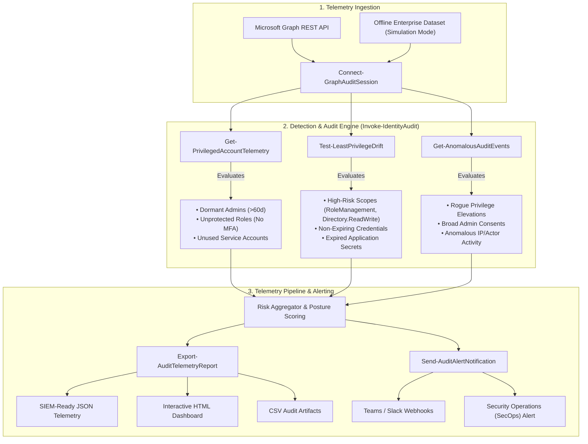

# Automated Systems Telemetry & Identity Auditing Framework

[](https://github.com/PowerShell/PowerShell)
[](https://azure.microsoft.com/en-us/products/active-directory)
[](https://learn.microsoft.com/en-us/graph/)
[]()
[](LICENSE)

An enterprise-grade, modular cybersecurity framework engineered to programmatically audit **Microsoft Entra ID** (formerly Azure Active Directory) environments. Using direct **Microsoft Graph REST API** integration, the framework continuously extracts directory telemetry, identifies dormant or unmonitored privileged accounts, catches high-risk permission drifts away from least-privilege baselines, and parses structured JSON directory audit logs to trigger real-time security alerts prior to credential exploitation.

---

## 🏛 Architecture Overview



---

## 🎯 Key Detection Capabilities

| Rule ID | Severity | Category | Description | Remediation Baseline |
| :--- | :---: | :--- | :--- | :--- |
| **`ID-AUD-001`** | `HIGH` | Privileged Identity | Privileged account dormant beyond threshold ($N$ days) | Revoke unused role or disable stale identity. |
| **`ID-AUD-002`** | `MEDIUM` | Privileged Identity | Active privileged account with no recorded sign-in telemetry | Verify provisioning intent and remove orphaned identities. |
| **`ID-AUD-003`** | `CRITICAL`| Privileged Identity | Highly privileged identity lacking enforced MFA | Enforce phishing-resistant Conditional Access policies immediately. |
| **`ID-AUD-101`** | `CRITICAL`| Permission Drift | App registration granted dangerous Graph scopes (`RoleManagement`, `Directory.ReadWrite`) | Restrict scopes to least-privilege delegated assignments. |
| **`ID-AUD-102`** | `LOW` | Drift Detection | Expired client secrets still attached to enterprise service principal | Prune expired credentials to prevent technical drift. |
| **`ID-AUD-103`** | `MEDIUM` | Drift Detection | Application secret configured with excessive lifetime (>2 years) | Implement automated certificate/secret rotation (<365 days). |
| **`ID-AUD-201`** | `CRITICAL`| Anomalous Log | Unauthorized administrative privilege elevation in audit logs | Trigger incident triage, verify ticket ID, revoke role. |
| **`ID-AUD-202`** | `HIGH` | Anomalous Log | Tenant-wide administrative consent granted to unverified apps | Audit granted permissions, revoke consent, invalidate tokens. |

---

## 🚀 Quickstart

### 1. Instant Offline Evaluation (Simulation Mode)
To evaluate the detection logic, telemetry ingestion, risk scoring, and reporting without needing an active Azure tenant:

```powershell
# Clone the repository
git clone https://github.com/hrana36/Automated-Systems-Telemetry-Identity-Auditing-Framework.git
cd Automated-Systems-Telemetry-Identity-Auditing-Framework

# Run complete audit in simulation mode
.\Start-Audit.ps1 -SimulationMode
```

This generates:
- **`Reports/identity-audit-report-*.html`** (Interactive executive and technical dashboard)
- **`Reports/identity-audit-findings-*.json`** (Structured telemetry for SIEM ingestion)
- **`Reports/identity-audit-findings-*.csv`** (Spreadsheet export)

### 2. Live Production Execution (Microsoft Entra ID)
To run against your live Microsoft Entra ID tenant via an App Registration with `Directory.Read.All` and `AuditLog.Read.All`:

```powershell
.\Start-Audit.ps1 `
    -TenantId "your-tenant-id" `
    -ClientId "your-app-client-id" `
    -ClientSecret "your-client-secret" `
    -InactivityThresholdDays 60 `
    -WebhookUrl "https://outlook.office.com/webhook/your-teams-webhook"
```

---

## 🧪 Automated Testing

The framework includes a comprehensive test suite written in **Pester** to validate detection rules, REST wrappers, and log parsing routines:

```powershell
Invoke-Pester -Script "./tests/IdentityAuditor.Tests.ps1"
```

Output:
```text
Describing IdentityAuditor Module Integrity
 [+] Successfully imports the IdentityAuditor module without errors
 [+] Exports all required public cmdlets
Describing Session Management & Telemetry Engine
 [+] Initializes a valid simulated session
 [+] Detects dormant and unprotected privileged accounts
 [+] Detects high-risk application scopes and secret drifts
 [+] Detects anomalous audit events and privilege elevations
 [+] Orchestrates full audit and computes posture score

Passed: 7 Failed: 0 Skipped: 0
```

---

## 📂 Project Structure

```text
Automated-Systems-Telemetry-Identity-Auditing-Framework/
│
├── .github/
│   └── workflows/
│       └── audit-ci.yml             # Automated CI pipeline for tests & simulation runs
│
├── src/
│   ├── IdentityAuditor.psd1         # Module manifest with metadata and exports
│   ├── IdentityAuditor.psm1         # Root module orchestrator
│   ├── Public/
│   │   ├── Connect-GraphAuditSession.ps1    # Authentication (OAuth2 Client Credentials & Simulation)
│   │   ├── Invoke-IdentityAudit.ps1         # Master orchestrator & posture score calculator
│   │   ├── Get-PrivilegedAccountTelemetry.ps1 # Rule engine for dormant & un-MFA'd admins
│   │   ├── Test-LeastPrivilegeDrift.ps1     # Rule engine for application permission drift
│   │   ├── Get-AnomalousAuditEvents.ps1     # Structured JSON audit log parser
│   │   ├── Export-AuditTelemetryReport.ps1  # Multi-format report exporter (HTML/JSON/CSV)
│   │   └── Send-AuditAlertNotification.ps1  # Webhook notification pipeline (Teams/Slack/SIEM)
│   │
│   └── Private/
│       ├── Invoke-GraphRestRequest.ps1      # Resilient Graph REST client (pagination & 429 backoff)
│       ├── Format-AuditFinding.ps1          # Standardized risk schema
│       └── Get-MockAuditDataset.ps1         # Realistic mock dataset generator
│
├── tests/
│   └── IdentityAuditor.Tests.ps1     # Pester unit & integration test suite
│
├── examples/
│   ├── sample-findings.json         # Real sample SIEM JSON telemetry
│   ├── sample-audit-report.html     # Pre-rendered HTML report
│   ├── sample-findings.csv          # Pre-rendered CSV report
│   └── config.example.json          # Configuration template
│
├── Start-Audit.ps1                  # Single command execution script
├── LICENSE                          # MIT License
└── README.md                        # Documentation & architecture
```

---

## 🔬 Research & Engineering Context

This project represents the practical realization of:
1. **Zero-Trust Identity Verification**: Enforcing continuous compliance monitoring rather than static perimeter defenses.
2. **Telemetry-Driven Threat Detection**: Mining structured event logs (`/auditLogs/directoryAudits`) and sign-in activity to detect privilege escalation before credential abuse occurs.
3. **Automated Policy-as-Code**: Programmatically translating least-privilege standards into repeatable, automated detection routines across hybrid and cloud directory architectures.

---

## 👤 Author

**Md Habibur Rahaman Rana**  
- **Email:** [hrana36@gmail.com](mailto:hrana36@gmail.com)  
- **LinkedIn:** [linkedin.com/in/hrana36](https://linkedin.com/in/hrana36)  
- **GitHub:** [github.com/hrana36](https://github.com/hrana36)  

---

## 📄 License

This project is licensed under the [MIT License](LICENSE).
